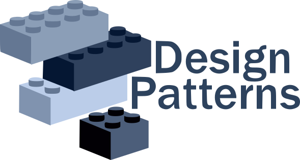

  

<h1 align="center">Design Patterns</h1>

Terminalowa aplikacja prezentująca zastosowanie klasycznych wzorców projektowych GoF (Design patterns) pod postacią modułu Maven. Głównym motywem jest tematyka restauracji (żeby projekt miał jakiś kontekst), ale przy okazji każdego wzorca będą inne praktyczne zastosowania.

Aplikacja jest podzielona na moduły względem typów wzorców:

1. Kreacyjne

| Wzorzec   | Zastosowanie w restauracji                                                  |
| --------- | --------------------------------------------------------------------------- |
| Singleton | Jedna wspólna konfiguracja restauracji: nazwa, stawka VAT, godziny otwarcia |
| Factory   | Method Tworzenie dań zależnie od kategorii: zupa, danie główne, deser       |
| Abstract  | Factory Całe zestawy menu zależnie od kuchni: włoska, polska, wegańska      |
| Builder   | Składanie złożonego zamówienia: stolik, dania, uwagi, kod rabatowy, napiwek |
| Prototype | Klonowanie gotowych zestawów, na przykład “lunch dnia”, z drobnymi zmianami |

1. Strukturalne

| Wzorzec   | Zastosowanie w restauracji                                                                       |
| --------- | :----------------------------------------------------------------------------------------------- |
| Adapter   | Integracja z zewnętrznym systemem płatności o niezgodnym interfejsie                             |
| Bridge    | Rozdzielenie rodzaju zamówienia (na miejscu, na wynos, dostawa) od sposobu realizacji            |
| Composite | Menu jako drzewo: kategorie zawierają dania i podkategorie, zestawy zawierają dania              |
| Decorator | Dodatki do dań: dodatkowy ser, ostry sos, większa porcja, każdy zmienia cenę i opis              |
| Facade    | Jeden prosty punkt wejścia do składania zamówienia, który ukrywa kuchnię, płatności i rabaty     |
| Flyweight | Współdzielenie obiektów typu przepis, alergen, ikona dania między tysiącami pozycji              |
| Proxy     | Kontrola dostępu i cache: na przykład tylko menedżer może zmieniać ceny, a menu jest cache’owane |

1. Behawioralne

| Wzorzec     | Zastosowanie w restauracji                                                                                        |
| ----------- | ----------------------------------------------------------------------------------------------------------------- |
| Strategy    | Wybór rodzaju zniżki: procentowa, kwotowa, happy hour, karta stałego klienta                                      |
| Observer    | Powiadamianie kuchni, kelnera i klienta o zmianie statusu zamówienia                                              |
| State       | Cykl życia zamówienia: nowe, w przygotowaniu, gotowe, wydane, anulowane                                           |
| Command     | Operacje na zamówieniu jako obiekty, z możliwością cofnięcia: dodaj danie, usuń danie                             |
| Chain       | of Responsibility Kolejne kroki walidacji i rabatów: poprawność zamówienia, dostępność składników, kod promocyjny |
| Template    | Method Wspólny szkielet przygotowania dania z różnymi krokami dla każdej kategorii                                |
| Iterator    | Przechodzenie po menu lub historii zamówień bez ujawniania struktury                                              |
| Mediator    | Koordynacja komunikacji między kelnerem, kuchnią i barem przez jeden węzeł                                        |
| Memento     | Zapis i przywracanie stanu zamówienia, na przykład wersja robocza lub cofnięcie zmian                             |
| Visitor     | Operacje na elementach menu bez zmiany ich klas: kalkulacja kalorii, raport alergenów, wyceny                     |
| Interpreter | Prosty język reguł rabatowych, na przykład “WTOREK AND SUMA > 100 THEN 10%”                                       |

W /docs można znaleźc notatki do poszczególnych wzorców.
